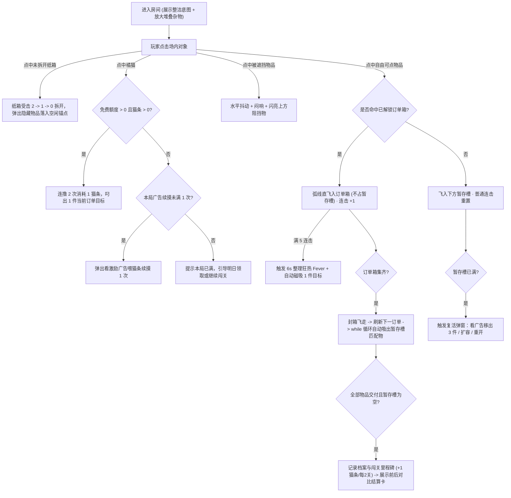

# 《收纳小当家（Tidy Home）》细化技术架构与无限关卡方案

> 基于 [收纳整理小游戏开发方案.html](../收纳整理小游戏开发方案.html) 进一步收敛产品共识，并**彻底脱离 Cocos Creator 账号与编辑器依赖**，升级为「纯 TypeScript 核心引擎 + 原生微信小游戏 Canvas 2D + 同源中控屏/H5 试玩」架构。

---

## 一、为何采用「纯 TS + 微信小游戏原生 / Web 同源」而非 Taro / uni-app

| 方案 | 适用类目 | 首包体量 & 帧率 | 账号依赖 | 结论 |
| :--- | :--- | :--- | :--- | :--- |
| **纯 TS + 原生小游戏 Canvas 2D (`minigame/`) + 同源 Web (`preview-web/`)** | **微信/抖音小游戏 + 中控屏/H5 网页** | **脚本包约 50KB**，零运行时框架开销，60fps 手势动画 | **零第三方引擎账号** | **采用（推荐）** |
| Taro / uni-app | 微信**小程序**（非小游戏） | 偏重（含框架运行时），只能以小程序载体上线，不支持小游戏类目与典型游戏激励视频变现体系 | 需小程序账号 | 不适合小游戏主航道 |
| Cocos Creator | 微信/抖音小游戏 | 需绑定开发者账号登录编辑器、插件环境较重 | 强依赖引擎账号 | 已移除 |

---

## 二、核心机制升级总览（针对触控放大、防无限刷猫、玩家档案、高级感 UI）

1. **中控屏与手机触控放大 + 48 种元素高复杂度曲线**：
   - Web/中控屏桌面视口放宽至 `500px` 宽（移动端自适应全屏）；
   - **元素种类翻倍**：`ITEM_CATALOG` 扩充至 **48 种**厚描边物品，内含 **12 组视觉混淆对**（手提包/双肩包、热咖啡/抹茶杯、草莓蛋糕/甜甜圈等），每间房扩至 **42 个自然透视锚点**；
   - **高复杂度锯齿波**：Lv.1 起即达 **33 件 / 8 类 / 3 层堆叠 + 快递纸箱**，Lv.2 升至 **48 件 / 12 类 / 4 层 + 3 击加固大箱**，高阶波次攀升至 **84–94 件 / 14–26 类 / 5 层深堆 + 多只加固大箱**，并通过「半埋藏策略发牌 + 2 层前瞻求解器」保证 **Lv.1–100 依然 100% 5 槽无死局可解**；
   - 场内物品视觉尺寸提升至 `82 * scale` px（微信原生 `132 * scale`），兼顾密集堆叠可读性与大面积触控手感。
2. **摸猫次数限制 + 用户档案 + 每日领取 + 闯关奖励**：
   - **每局免费摸猫上限 = 1 次**，且消耗 `1` 份用户账户内 **摸猫机会（猫条）**；
   - 本局免费用完或猫条余额为 `0` 时再摸猫，弹出激励视频续摸提示（**每局最多额外看广告续摸 1 次**），整局绝对上限 2 次，彻底堵死无限白嫖物品漏洞；
   - **每日领取**：每天免费领取 `2` 次（每次 `+1`），额外可看广告领 `1` 次（`+1`），跨天自动刷新；
   - **闯关奖励**：每累计通关 **2 关** 自动奖励 `+1` 摸猫机会；
   - **用户档案持久化**：记录 `userId`、`nickname`、`petTreats`、`totalLevelsCleared`、`totalStars`、`dailyClaimDate`、`dailyFreeClaimed`、`dailyAdClaimed` 及关卡进度（兼容旧存档平滑迁移）。
3. **定制手绘厚描边 UI 图标套件（零丑陋系统 Emoji）**：
   - 新增 21 枚 `128×128` 透明 PNG 图标（`assets/resources/ui/icon_*.png`），与房间插画、物品素材保持完全统一的 `#3D2B24` 深棕粗描边 + 暖色高光语言。
4. **完整外围系统与局内体验闭环**：
   - **温馨首页大厅**：每次打开先入首页（最新解锁房间柔焦底图 + 《收纳小当家》招牌 + 动态橘猫 + 开始/继续整理按钮 + 每日补给 / 房间选关 / 玩法说明 / 设置入口）；
   - **设置与暂停页**：支持音效、触感震动开关、背景音预留开关、昵称修改、隐私保护指引、二次确认重置存档及局内重玩/返回首页；
   - **房间选关与星级防刷**：记录每关最高星数 `levelStars`，重玩历史关只累加差额星数且不回退主线进度；任意弹窗或首页状态下自动暂停局内计时与橘猫动作。

---

## 三、核心玩法状态机



---

## 四、目录结构（纯 TS 无第三方引擎依赖）

```text
tidy-home/
├── src/
│   ├── core/                  # 纯 TS 核心引擎（零 DOM / 零引擎 API）
│   │   ├── types.ts           # 关卡/状态机/用户档案完整类型
│   │   ├── rng.ts             # Mulberry32 确定性随机数
│   │   ├── userProfile.ts     # 每日领取、跨天重置、每2关奖励、档案统计
│   │   ├── catalogs.ts        # 3 房间锚点、房主吐槽、24 种物品定义
│   │   ├── levelGenerator.ts  # 无限关生成 + DAG 遮挡 + 5 槽可解性校验
│   │   └── gameSession.ts     # 核心状态机（含摸猫限次与广告续摸）
│   ├── platform/              # 跨端适配（Web Mock / 微信 wx / 抖音 tt）
│   └── minigame/
│       └── main.ts            # 微信/抖音原生 Canvas 2D 渲染入口
├── assets/resources/
│   ├── rooms/                 # 3 张 AI 暖色扁平插画底图 (720×1280 PNG)
│   ├── sprites/               # 29 张厚描边物品/纸箱/橘猫 (256×256 PNG)
│   ├── ui/                    # 14 张定制手绘厚描边 UI 图标 (128×128 PNG)
│   ├── audio/                 # 12 个合成马林巴/交互 WAV 音效
│   └── configs/               # rooms.json / items.json
├── preview-web/               # 中控屏 / 手机浏览器同源试玩入口
├── minigame/                  # `npm run build:minigame` 一键产出的微信小游戏原生包
├── scripts/                   # 素材生成脚本 + 小游戏构建脚本
└── tests/core.test.ts         # Vitest 核心单测
```

---

## 五、常用开发与发布命令

- **本地中控屏 / 浏览器试玩**：`npm run dev`（访问 `http://127.0.0.1:5173`）
- **运行自动化单测（含 Lv.1–100 可解性与档案奖励）**：`npm test`
- **全工程 TypeScript 类型检查**：`npm run typecheck`
- **构建生产级 Web / H5 包**：`npm run build:web`（产物在 `preview-web/dist/`）
- **一键导出微信小游戏原生工程**：`npm run build:minigame`（产物在 `minigame/`）

### 微信开发者工具 3 步运行原生小游戏
1. 执行 `npm run build:minigame` 生成最新 `minigame/` 目录。
2. 打开 **微信开发者工具 → 小游戏 → 导入项目**，选择目录 `/Volumes/T7 Mac/Development/games/tidy-home/minigame`（测试阶段选「测试号」或填入自己的小游戏 AppID）。
3. 直接预览或真机调试；上线时在 [WeChatAdapter.ts](../src/platform/WeChatAdapter.ts) 填入真实 `rewardedVideoAdUnitId`，并将 `rooms/` 切为分包或 CDN 远程加载以压入首包 4MB 红线。
